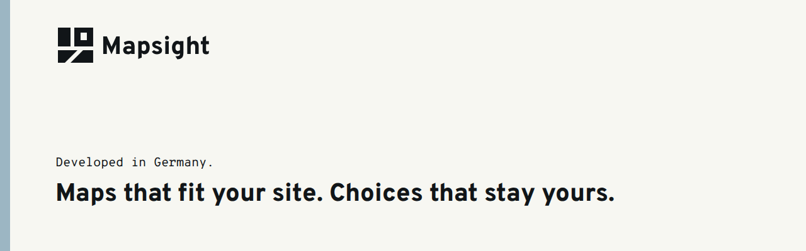

# Mapsight

Mapsight is an open-source framework for communicative web maps: thematic maps on an organisation's website, designed to match its look and built on open standards.

**Status:** Work in progress; used in controlled production deployments, not yet turnkey.

- [Mapsight repository](https://github.com/open-mapsight/mapsight): packages, apps and starters
- [Documentation](https://github.com/open-mapsight/mapsight/blob/main/docs/README.md)
- [Live showcase](https://showcase.open-mapsight.org)
- Contact: [contact@open-mapsight.org](mailto:contact@open-mapsight.org)
